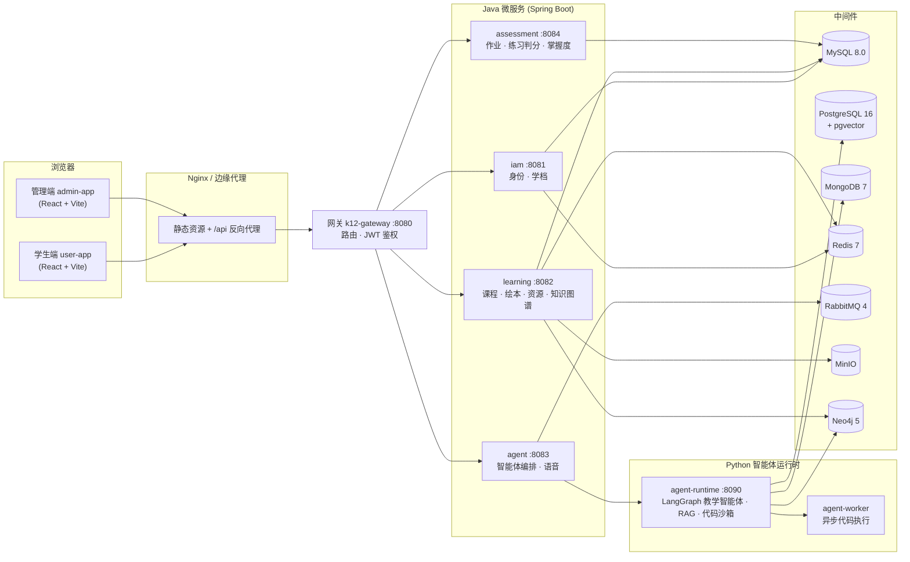

# K12 智能体学习平台 · 系统集成部署方案

> 本文面向评审与集成方，说明系统的整体架构、两种部署方式（Docker Compose 一键部署 / 在线演示站点）、
> API 对接规范与页面嵌入方案。全部接口均已在公网演示站点实际开放，可直接联调验证。

## 1. 系统概览

平台采用「统一网关 + 微服务 + Python 智能体运行时」架构，前端为学生端（小学/中学双体验）与管理端两个 SPA 应用。



**技术栈**：Spring Boot / Spring Cloud Gateway（Java 侧），LangGraph + DashScope 通义千问（Python 智能体侧），
React + Vite + Monaco + Blockly（前端），MySQL / PostgreSQL+pgvector / MongoDB / Redis / RabbitMQ / MinIO / Neo4j（存储与中间件）。

## 2. 部署方案

### 2.1 方式一：Docker Compose 一键部署（推荐）

仓库自带完整部署编排，一条命令拉起全部 16 个容器（7 中间件 + 5 Java 服务 + agent-runtime + agent-worker + 前端）：

```bash
git clone <仓库地址> && cd k12/deploy/server
cp .env.example .env                  # 配置数据库口令、DASHSCOPE_API_KEY 等环境变量
bash deploy-all.sh                    # 构建镜像并按依赖顺序启动，内置健康检查
```

- 编排文件：`deploy/server/compose.yaml`（含 `middleware` / `app` 两个 profile，可分层启停）
- 前端由 `web` 容器内的 Nginx 托管，并将 `/api` 反代到网关 :8080
- 代码沙箱如需外置执行引擎，可另起 `deploy/piston/compose.yaml`
- 资源建议：≥ 4 vCPU / 8 GB 内存 / 40 GB 磁盘

### 2.2 方式二：在线演示站点（已上线，开箱即用）

| 站点 | 地址 | 说明 |
|---|---|---|
| 学生端 | https://k12-demo.sites.knodo.vip | 小学/中学双学段体验，支持自行注册 |
| 管理端 | https://k12-admin.sites.knodo.vip | 课程/绘本/资源/作业后台，演示账号 `admin / admin123` |

### 2.3 配置项

所有敏感配置集中在 `deploy/server/.env`（模板 `.env.example`）：数据库口令、`JWT_SECRET`、
`DASHSCOPE_API_KEY`（通义千问大模型与语音）、MinIO/Neo4j 凭据等。JWT 有效期由
`K12_JWT_ACCESS_TOKEN_TTL` 控制（演示环境设为 12h，避免演示中频繁过期）。

## 3. API 对接方案

### 3.1 接入约定

| 约定 | 说明 |
|---|---|
| Base URL | `https://<域名>/api/v1/<服务域>/...`，四个服务域：`iam` / `learning` / `agents` / `assessments` |
| 响应信封 | 统一 `{ "code": 200, "message": "ok", "data": …, "timestamp": … }`，业务数据在 `data` 中 |
| 鉴权 | 除标注 `public` 的接口外均需登录；请求头 `Authorization: Bearer <accessToken>` |
| 兼容头 | 若前端部署在会剥离 `Authorization` 的边缘代理之后，可改发 `X-K12-Token: <accessToken>`，网关侧等价 |
| 公开接口 | 绘本、图形化任务、已发布教学资源等只读接口无需登录（`picture-books/published`、`teaching-resources/published` 等） |

### 3.2 认证流程

```bash
# ① 登录获取令牌
curl -X POST https://k12-demo.sites.knodo.vip/api/v1/iam/auth/login \
  -H "Content-Type: application/json" \
  -d '{"username":"<学生账号>","password":"<密码>"}'
# → data.accessToken (JWT)，有效期见 K12_JWT_ACCESS_TOKEN_TTL

# ② 携带令牌调用业务接口（示例：读取知识掌握度）
curl https://k12-demo.sites.knodo.vip/api/v1/assessments/practice-attempts/me/mastery \
  -H "Authorization: Bearer <accessToken>"
```

### 3.3 核心接口清单

**身份与学习档案（iam）**

| 方法 | 路径 | 用途 |
|---|---|---|
| POST | `/api/v1/iam/auth/register` · `/auth/login` | 注册 / 登录 |
| GET/PUT | `/api/v1/iam/users/me/learning-profile` | 学段（小学低/高、初中、高中）、年级、教材、兴趣——个性化依据 |

**课程与资源（learning）**

| 方法 | 路径 | 用途 |
|---|---|---|
| GET | `/api/v1/learning/courses` · `/courses/{id}` · `/courses/{id}/chapters` | 课程目录 / 详情 / 章节 |
| POST | `/api/v1/learning/courses/personalized` | 按知识掌握度个性化荐课 |
| GET | `/api/v1/learning/picture-books/published[/{code}]` | 互动绘本（公开） |
| GET | `/api/v1/learning/teaching-resources/published` | 教学资源（pdf/docx/pptx/mp4，公开检索，下载走预签名 URL） |
| POST | `/api/v1/learning/knowledge-graph/recommendations/next` | 知识图谱：下一步学什么 |
| GET/PUT | `/api/v1/learning/visual-programming/...` | 图形化编程任务与项目保存 |

**智能体（agents）**

| 方法 | 路径 | 用途 |
|---|---|---|
| GET | `/api/v1/agents` | 智能体清单（`teaching-assistant` 中学 / `lower-primary-tutor` 小学低年级） |
| POST | `/api/v1/agents/{agentCode}/runs` | 发起对话/讲解/练习生成，支持 SYNC/ASYNC 与上下文（学段、教材、topicCode、会话历史） |
| GET | `/api/v1/agents/runs/{runId}/artifacts` | 获取产出工件：小测（quiz）、分步动画（animation/lesson-steps）等 |
| POST | `/api/v1/agents/code-executions` | Python 代码沙箱执行（配套在线编程环境） |
| POST | `/api/v1/agents/speech/synthesize` | 云语音合成（低年级朗读） |

**练习与测评（assessments）**

| 方法 | 路径 | 用途 |
|---|---|---|
| POST | `/api/v1/assessments/practice-attempts` | 提交练习，服务端自动判分 |
| GET | `/api/v1/assessments/practice-attempts/me/mastery` · `/me/insights` | 知识掌握度 / 练习洞察（个性化闭环数据源） |
| GET/POST | `/api/v1/assessments/homeworks/...` | 作业列表 / 题目 / 提交 / 学习报告 |

### 3.4 前端调用示例

```javascript
// 登录并调用智能体（与平台前端同款调用方式）
const login = await fetch("/api/v1/iam/auth/login", {
  method: "POST", headers: { "Content-Type": "application/json" },
  body: JSON.stringify({ username, password }),
}).then(r => r.json());
const token = login.data.accessToken;

const run = await fetch("/api/v1/agents/lower-primary-tutor/runs", {
  method: "POST",
  headers: { "Content-Type": "application/json", "Authorization": `Bearer ${token}` },
  body: JSON.stringify({
    inputText: "讲一个小猫识别的小故事",
    sessionId: "demo-session-1",
    executionMode: "SYNC",
    context: { stage: "lower_primary", topicCode: "machine_learning.image_classification" },
  }),
}).then(r => r.json());
// run.data.outputText     → 讲解正文（Markdown）
// run.data.artifacts      → 小测 / 动画等工件，可直接渲染
// run.data.outputMetadata → 引导卡协议（LOOK→THINK→TRY choices）等元数据
```

## 4. 页面嵌入方案

学生端为单页应用（hash 路由），可整站或按页嵌入第三方平台（学校 LMS、班级空间等）。

### 4.1 iframe 嵌入

```html
<!-- 嵌入整站 -->
<iframe src="https://k12-demo.sites.knodo.vip/" width="1280" height="800"
        allow="microphone; autoplay" style="border:0;"></iframe>

<!-- 深度链接：直接打开某个页面 -->
<!-- 问问小智 / 课程中心 / 猫咪侦探课 / 我的成长 -->
<iframe src="https://k12-demo.sites.knodo.vip/#ai-studio" ...></iframe>
```

可用深度链接：`#home` 首页 · `#ai-studio` 智能体对话 · `#courses` 课程 ·
`#picture-books` 绘本 · `#cat-lesson` 猫咪侦探课 · `#visual-code-lab` 编程实验室 · `#progress` 学习报告。

### 4.2 登录态注入（免二次登录）

前端登录态存于 `localStorage["k12-user-auth"]`（含 `accessToken` 与用户信息）。宿主平台完成自身登录后，两种方式注入：

```html
<script>
  // 方式 A：宿主与平台同域部署（推荐，经反向代理挂载到同域路径）
  localStorage.setItem("k12-user-auth", JSON.stringify({
    accessToken: "<token>", username: "xxx", authorities: ["ROLE_STUDENT"],
  }));
  // 随后加载 iframe，即以该身份进入
</script>
```

跨域场景使用 postMessage 握手：宿主向 iframe `postMessage({ type: "K12_AUTH", token }, 目标源)`，
平台端监听后写入登录态（约 20 行胶水代码，可按集成方需求提供）。

### 4.3 典型集成场景

| 场景 | 做法 |
|---|---|
| 第三方课表跳转学习 | 携带 topicCode 深链到 `#ai-studio`，智能体按学段直接开讲 |
| 课内嵌智能体问答 | iframe 嵌入 `#ai-studio`，登录态按 4.2 注入 |
| 成绩回流宿主 LMS | 轮询 `practice-attempts/me` 与 `homeworks/learning-results/me` 同步判分结果 |

## 5. 安全与运维要点

- **传输与鉴权**：全站 HTTPS；JWT 签名令牌，网关统一校验，服务间不互信来源；学生口令 BCrypt 存储
- **密钥管理**：全部敏感配置经 `.env` 注入，不落代码库（仓库仅含 `.env.example` 模板）
- **代码沙箱**：学生代码经独立执行服务隔离运行（超时熔断、禁临时装包、异常不泄露供应商信息）
- **低龄内容安全**：小学低年级智能体内置儿童口吻与内容护栏（危险/不适话题引导询问家长老师）；中学端保留审定主题范围控制
- **健康检查与自愈**：compose 为每个服务定义 healthcheck；生产脚本 `deploy-all.sh` 按依赖顺序启动并校验
- **可观测**：智能体调用链路（输入/产出/工件）落 MongoDB，可在管理端审计

---

*本文档对应仓库 `docs/integration-guide.md`，接口清单与前端 `src/api/client.js` 保持同步；部署细节另见 `docs/deployment-guide.md` 与 `docs/server-migration-deployment.md`。*
